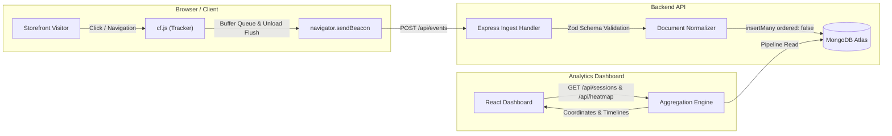

# CausalFunnel Analytics

A privacy-conscious, lightweight event tracker, ingest engine, and analytics dashboard designed for storefront interaction analysis.

[](https://github.com/codex-yasxh/user-analytics-application/actions/workflows/ci.yml)

---

## Try It in 60 Seconds

The full hosted stack is deployed, seeded, and accessible online:

- **Demo Store:** [https://causal-funnel-dashboard-gamma.vercel.app/demo/home.html](https://causal-funnel-dashboard-gamma.vercel.app/demo/home.html)
- **Analytics Dashboard:** [https://causal-funnel-dashboard-gamma.vercel.app/](https://causal-funnel-dashboard-gamma.vercel.app/)
- **API Health Check:** [https://user-analytics-application-causalfunnel.onrender.com/health](https://user-analytics-application-causalfunnel.onrender.com/health)
- **API Readiness Check:** [https://user-analytics-application-causalfunnel.onrender.com/ready](https://user-analytics-application-causalfunnel.onrender.com/ready)
- **Walkthrough Video:** [Watch 2-Minute Video Walkthrough](https://youtu.be/placeholder) _(2m 30s demonstration: live tracking, session timeline, heatmap, and CI verification)_

> **Note on Cold Starts:** The backend API is hosted on Render's free tier. If the service has been idle, spin-up may take 30–60 seconds on the first request. The dashboard includes a built-in waking indicator with automatic exponential backoff retry.

---

## What's in the Box

- **Tracker (`cf.js`):** Standalone IIFE (4.9 KB raw, 2.4 KB gzip) with zero runtime dependencies. Tracks pageviews (including SPA history transitions) and clicks. Batches events, flushes on interval, and guarantees best-effort flush on page unload via `navigator.sendBeacon` with `fetch(keepalive)` fallback.
- **Ingest Engine:** Express 5 HTTP server with Zod schema validation. Uses native MongoDB driver with unordered bulk inserts (`ordered: false`) to handle duplicate retries idempotently via unique index constraints.
- **Analytics Dashboard:** React 19, TypeScript, Tailwind CSS, and Vite. Displays paginated session journeys, relative event timelines, and a canvas heatmap with viewport bucketing.
- **Demo Store:** Multi-page storefront (Home, Product, Checkout) featuring a floating diagnostic chip displaying active tracking state, queued/sent event counts, and a direct link to view the current session.
- **Automated Test Suite:** 116 passing unit and integration tests across 4 npm workspaces (`@cf/shared`, `@cf/server`, `@cf/tracker`, `@cf/dashboard`) running against real MongoDB instances in CI.

---

## Run Locally

### Prerequisites

- Node.js 22+ (refer to `.nvmrc`)
- Docker Desktop (for local containerized MongoDB) or an existing MongoDB connection string

### Quick Start (with Docker)

1. Clone the repository and configure environment variables:

   ```bash
   cp .env.example .env
   npm ci
   ```

2. Start the local MongoDB service:

   ```bash
   npm run db:up
   ```

3. Synchronize database indexes and seed realistic demo sessions:

   ```bash
   npm run db:sync
   npm run seed
   ```

4. Launch API server, dashboard, and tracker build watcher concurrently:

   ```bash
   npm run dev
   ```

5. Access local endpoints:
   - **Demo Store:** [http://localhost:5173/demo/home.html](http://localhost:5173/demo/home.html)
   - **Dashboard:** [http://localhost:5173/](http://localhost:5173/)
   - **API Server:** [http://localhost:4000/health](http://localhost:4000/health)

### Running Without Docker

If running a local `mongod` service or using MongoDB Atlas directly:

1. Update `MONGO_URL` in `.env` with your connection URI (e.g., `mongodb://127.0.0.1:27017/cf`).
2. Run `npm run db:sync` and `npm run seed`.
3. Start the dev processes via `npm run dev`.

### Verification Suite

Run linting, typechecking, code formatting checks, and the full test suite across all packages:

```bash
npm run check
```

---

## Embedding the Tracker

Add the following tag to the `<head>` or `<body>` of your website. The script is served from the static host so it loads immediately even if the API server is warming up:

```html
<script
  src="https://causal-funnel-dashboard-gamma.vercel.app/cf.js"
  data-endpoint="https://user-analytics-application-causalfunnel.onrender.com/api/events"
  defer
></script>
```

### Configuration Attributes

| Attribute       | Required | Description                                                     |
| --------------- | -------- | --------------------------------------------------------------- |
| `src`           | Yes      | URL to `cf.js` on the static host.                              |
| `data-endpoint` | Yes      | Ingest API URL for batch event collection (`POST /api/events`). |

### Client-Side Diagnostic Object

The tracker exposes `window.__cf` on the global scope for introspection and debugging:

```javascript
// Inspect tracker status
console.log(window.__cf.sessionId); // Current UUID v4 session ID
console.log(window.__cf.status); // "active" | "paused"
console.log(window.__cf.eventsQueued); // Current buffer length
console.log(window.__cf.eventsSent); // Cumulative events handed to browser

// Manually enable tracking if paused by DNT or GPC
window.__cf.enable();
```

---

## How It Works



### Event Lifecycle

1. **Initialization & Privacy Check:** `cf.js` executes immediately in an isolated IIFE. It checks `navigator.doNotTrack` and `navigator.globalPrivacyControl`. If privacy signals are active, tracking pauses with zero network egress. The top-frame guard (`window !== window.top`) prevents tracking inside iframes (such as the dashboard heatmap preview), and `?cf_ignore` disables tracking for administrative inspection.
2. **Session Assignment:** A deterministic UUID v4 session ID is created and stored in `localStorage` (with a cookie fallback). Sessions reset automatically after 30 minutes of inactivity.
3. **Event Buffering:**
   - **Pageviews:** Dispatched on initial load and on client-side routing (`pushState`, `replaceState`, `popstate`) whenever the normalized path changes.
   - **Clicks:** Captured via document capture listener. Captures document scroll-relative coordinates (`pageX`, `pageY`), document dimensions (`doc_w`, `doc_h`), viewport size (`vw`, `vh`), and a clean CSS selector (`sel`). Input values (`.value`) and inner text are strictly excluded.
4. **Resilient Flush:** Events are queued in memory (capped at 100 events). Flushes trigger every 3 seconds, upon collecting 10 events, or on page hide / unload via `navigator.sendBeacon` (using a `text/plain` Blob payload to bypass CORS preflights). If beaconing is unsupported, `fetch` with `keepalive: true` is used. Failed network attempts retry with exponential backoff up to 3 times.
5. **Idempotent Storage & Ingestion:** The server assigns server-side fields (`received_at`, `vw_bucket`, `src: "live"`, sanitized `path`). It executes unordered batch inserts (`insertMany(docs, { ordered: false })`). Thanks to the unique index on `{ eid: 1 }`, retried network batches skip duplicate events seamlessly while storing all new events, returning an accurate breakdown: `202 { accepted, duplicates, rejected }`.

---

## API Specification

All endpoints communicate using JSON and follow a consistent error format:

```json
{
  "error": {
    "code": "BAD_REQUEST | NOT_FOUND | INGEST_DISABLED | INTERNAL_ERROR",
    "message": "Descriptive error message"
  }
}
```

| Method | Endpoint                   | Description                                                      | Query / Body Parameters                                                  |
| ------ | -------------------------- | ---------------------------------------------------------------- | ------------------------------------------------------------------------ |
| `POST` | `/api/events`              | Ingests a batch of events (1–50 items).                          | Body: `{ events: [ ... ] }` (JSON or `text/plain`)                       |
| `GET`  | `/api/sessions`            | Lists paginated user sessions ordered by newest activity.        | `limit` (default 20, max 100), `page` (default 1)                        |
| `GET`  | `/api/sessions/:id/events` | Retrieves full event journey timeline for a given session.       | Path param: `:id` (UUID v4)                                              |
| `GET`  | `/api/pages`               | Summarizes unique page paths ranked by total clicks and views.   | None                                                                     |
| `GET`  | `/api/heatmap`             | Retrieves click coordinates for a path within a viewport bucket. | `path` (required), `bucket` (`desktop` \| `tablet` \| `mobile`), `limit` |
| `GET`  | `/health`                  | Liveness health check.                                           | Returns `{ status: "ok" }`                                               |
| `GET`  | `/ready`                   | Readiness check verifying database connectivity.                 | Returns `{ status: "ok", db: "connected" }`                              |

---

## Architectural Decisions & Trade-Offs

| Decision                                               | Trade-Off / Cost                                                                     | Rationale & Mitigation                                                                                                                                                                                                  |
| ------------------------------------------------------ | ------------------------------------------------------------------------------------ | ----------------------------------------------------------------------------------------------------------------------------------------------------------------------------------------------------------------------- |
| **Native MongoDB Driver (No Mongoose)**                | No automatic schema middleware or ORM casting.                                       | Eliminates ORM overhead; single source of truth using shared Zod schemas. Enables fine-grained bulk write error extraction (`MongoBulkWriteError` code 11000) for duplicate detection.                                  |
| **Single `events` Collection for Sessions**            | Session aggregation pipeline requires an index-assisted group scan over events.      | Avoids distributed two-phase writes during high-throughput ingest. At massive scale, a dedicated `sessions` collection updated incrementally at ingest would mitigate aggregation latency.                              |
| **`text/plain` Beacon Ingestion**                      | Express must parse stringified JSON manually for beacon requests.                    | Browser `sendBeacon` with standard `application/json` triggers CORS preflight `OPTIONS` requests, which browsers frequently drop during page unload. `text/plain` bypasses preflights, maximizing delivery reliability. |
| **Viewport Bucketing (`desktop`, `tablet`, `mobile`)** | Clicks on different viewport widths within the same bucket scale uniformly.          | Responsive layouts reflow dramatically across mobile and desktop. Bucketing isolates coordinates to consistent DOM layouts (reference widths: 1280, 768, 390).                                                          |
| **Open Ingest CORS vs. Restricted Reads**              | Read APIs are restricted to `DASHBOARD_ORIGIN`; ingest is open to all origins (`*`). | Trackers must accept events from arbitrary customer storefronts. CORS is not an authentication layer; open read APIs are a deliberate scope choice for this demo.                                                       |

---

## Heatmap Projection & Coordinate Math

Rendering clicks accurately across diverse display resolutions requires a normalized reference canvas rather than raw screen pixels:

1. **Uniform Aspect Ratio Scaling:** The dashboard computes a uniform scale factor based on the reference bucket width:
   $$\text{scale} = \frac{\text{renderWidth}}{\text{doc\_w}}$$
   $$\text{px} = x \times \text{scale}, \quad \text{py} = y \times \text{scale}$$
   Independent $x/\text{doc\_w}$ and $y/\text{doc\_h}$ ratios are strictly avoided to prevent aspect ratio distortion on tall or dynamic pages.
2. **Subpixel Sharpness:** Canvases are scaled by `window.devicePixelRatio` with CSS dimensions matched to the underlying iframe preview.
3. **Radial Density Gradients:** Click clusters render with additive alpha blending (`lighter` composite operation) and color-mapped density thresholds (cool blue $\rightarrow$ teal $\rightarrow$ intense red).
4. **Renderable Fallback:** Pages hosted on the demo origin render inside an isolated preview iframe (`?cf_ignore` appended). Cross-origin or unframeable URLs automatically render on an interactive coordinate grid with clear diagnostic notices.

---

## Privacy, Do Not Track, and GPC Compliance

The tracking agent is engineered with strict data minimization principles:

- **No Form Data or Input Values:** Input values, password fields, textareas, and select choices are never read or stored.
- **No Inner Text or DOM Content:** Element selectors record only structural hierarchy (`tag`, `id`, and primary class names) up to 120 characters, omitting inner text, HTML attributes, and query parameters.
- **No IP Address or User-Agent Logging:** Client IPs and raw user agents are stripped prior to persistence.
- **Honoring User Consent Signals:** `cf.js` checks `navigator.doNotTrack` and `navigator.globalPrivacyControl`. When enabled, tracking halts immediately. In the demo store, visitors can use the diagnostic status chip to review the paused state or grant explicit local testing opt-in.
- **Self-Tracking Prevention:** The tracker verifies `window === window.top`. When running inside an iframe (such as during heatmap preview generation), tracking is deactivated to protect analytic integrity.

---

## Known Limitations & Edge Cases

- **Sticky and Fixed Elements:** Clicks on CSS `position: fixed` or `position: sticky` headers record page-relative scroll coordinates. If users scroll before clicking, coordinates render at their absolute document offset rather than pinned to the viewport.
- **Responsive Layout Reflow:** If an e-commerce page dramatically alters element geometry between 1024px and 1279px (both within the `desktop` bucket), click blobs may display slight visual offset relative to underlying buttons.
- **Hash-Based Routing:** Pages navigating solely via URL hash fragments without pathname changes do not trigger duplicate `page_view` events.
- **Third-Party Iframe Sandboxing:** Previewing external customer domains inside the dashboard heatmap requires reverse proxying or DOM snapshot archival to bypass cross-origin framing barriers (`X-Frame-Options` / CSP).

---

## Deliberate Scope Choices (What I'd Build Next)

The following items represent deliberate scope boundaries chosen to prioritize tracker reliability, data integrity, and pipeline clarity:

1. **Real-Time Streaming / WebSockets:** Polling and cache-aware fetches were preferred over WebSockets to ensure predictable server resource consumption and operational simplicity.
2. **Dedicated Sessions Collection:** For multi-million event scale, maintaining an incrementally updated `sessions` collection at ingestion time would eliminate aggregation query cost.
3. **Authentication & Multi-Tenant RBAC:** Kept read endpoints open to streamline reviewer evaluation without credential provisioning. Production deployment would enforce API key authentication and tenant isolation.
4. **Element-Relative Offset Normalization:** Storing coordinates relative to individual element bounding boxes (`offsetX`, `offsetY`) would solve fixed-header drift across dynamic layouts.
5. **Session Replay:** Full DOM mutation recordings (e.g., rrweb) were intentionally excluded to maintain zero tracker dependencies and ensure total end-user privacy.

---

## Repository Map

```text
.
├── packages/
│   └── shared/           # Zod event schemas, path normalizers, fixtures, viewport bucket helpers
├── tracker/              # cf.js source, esbuild bundler, jsdom unit tests
├── server/               # Express 5 backend API, MongoDB aggregation pipelines, integration tests
├── dashboard/            # React 19 + Vite analytics UI, sessions list, journey, canvas heatmap
├── demo/                 # Multi-page demo storefront with interactive tracking status chip
├── scripts/              # Database index sync (sync-indexes.ts) and realistic session seeder (seed.ts)
├── .github/workflows/    # Continuous integration pipeline (lint, typecheck, format, tests)
├── docker-compose.yml    # Containerized MongoDB environment
├── vercel.json           # Static deployment configuration with client-side SPA routing rewrites
└── README.md             # Project documentation and architectural overview
```
