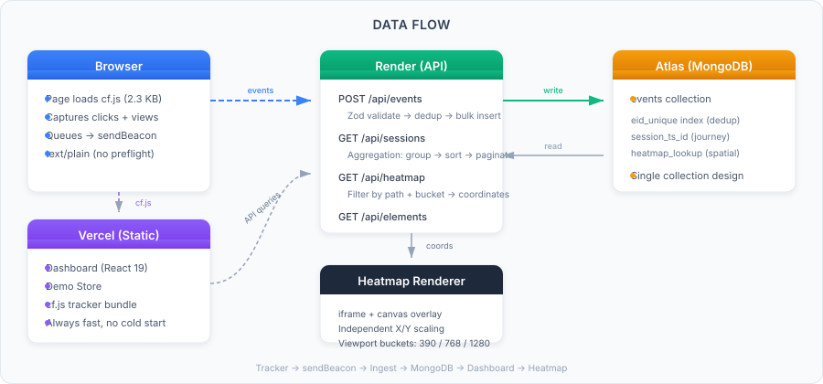

# CausalFunnel Analytics

Drop a 2.3 KB script on any page — get sessions, journeys, and heatmaps.

[](https://github.com/codex-yasxh/user-analytics-application-CausalFunnel/actions/workflows/ci.yml)

<!-- TODO: replace with a hero GIF showing: click demo store → session appears → heatmap lights up -->

---

## Try It in 60 Seconds

1. Open the **[Demo Store](https://causal-funnel-dashboard-gamma.vercel.app/demo/home.html)** and click a few "Add to Cart" buttons
2. Click **"Open my session"** in the status chip (bottom-right corner)
3. See your clicks in the **[Dashboard](https://causal-funnel-dashboard-gamma.vercel.app/)** — session timeline, heatmap, top elements

| Link          | URL                                                                                                                                        |
| ------------- | ------------------------------------------------------------------------------------------------------------------------------------------ |
| Dashboard     | [https://causal-funnel-dashboard-gamma.vercel.app](https://causal-funnel-dashboard-gamma.vercel.app/)                                      |
| Demo Store    | [https://causal-funnel-dashboard-gamma.vercel.app/demo/home.html](https://causal-funnel-dashboard-gamma.vercel.app/demo/home.html)         |
| API Health    | [https://user-analytics-application-causalfunnel.onrender.com/health](https://user-analytics-application-causalfunnel.onrender.com/health) |
| Preview Video | [Google Drive](https://drive.google.com/drive/folders/1s7bSR_BsclL-jpHlNQI3lQ4SoazSYMB7?usp=sharing)                                       |

> API is on Render free tier — first request after idle takes 30–60s. The dashboard shows a "waking" banner and retries automatically.

---

## Proof Tests

Two Playwright tests prove the two hardest claims — beacon delivery and heatmap accuracy:

```bash
npm run test:proof-beacon     # navigate away triggers sendBeacon, events appear in Mongo
npm run test:proof-heatmap    # click a known button, assert heatmap dot lands inside it
```

77 unit/integration tests cover the rest:

```bash
npm run check                 # lint + typecheck + prettier + all tests
```

---

## Run Locally

**With Docker (one command):**

```bash
cp .env.example .env
npm ci
docker compose up             # Mongo + API + dashboard + seed
```

**Without Docker:**

```bash
cp .env.example .env
npm ci
npm run db:sync               # create indexes (set MONGO_URL in .env first)
npm run seed                  # seed 30 demo sessions
npm run dev                   # start API + dashboard + tracker watcher
```

Dashboard: [localhost:5173](http://localhost:5173) · Demo Store: [localhost:5173/demo/home.html](http://localhost:5173/demo/home.html) · API: [localhost:4000/health](http://localhost:4000/health)

---

## Embed the Tracker

```html
<script
  src="https://causal-funnel-dashboard-gamma.vercel.app/cf.js"
  data-endpoint="https://user-analytics-application-causalfunnel.onrender.com/api/events"
  defer
></script>
```

| Attribute       | Required    | Description                        |
| --------------- | ----------- | ---------------------------------- |
| `src`           | Yes         | URL to the hosted `cf.js` tracker  |
| `data-endpoint` | Yes         | API ingest endpoint                |
| `defer`         | Recommended | Loads without blocking page render |

2.3 KB gzipped. Zero dependencies. Works on any site. Respects DNT and GPC.

---

## How It Works

<p align="center">
  
</p>

1. **Tracker** captures `page_view` and `click` events with page coordinates, viewport size, and a CSS selector
2. **Queue** batches events (3s interval or 10-event threshold) and flushes via `sendBeacon` (text/plain to avoid CORS preflight)
3. **Ingest** validates with Zod, deduplicates on `eid`, strips query strings for privacy
4. **Dashboard** reads sessions, journeys, heatmaps, and top-clicked elements via aggregation pipelines
5. **Heatmap** renders clicks on an iframe of the actual page with independent X/Y coordinate scaling and viewport bucketing

See [Architecture](docs/architecture.md) for the full data flow.

---

## Stack

| Layer     | Tech                                                            |
| --------- | --------------------------------------------------------------- |
| Tracker   | TypeScript → esbuild IIFE (`cf.js`), 2.3 KB gzip, 0 deps        |
| API       | Express 5, Zod validation, native MongoDB driver                |
| Database  | MongoDB (Atlas hosted, local via Docker)                        |
| Dashboard | React 19, Vite, TypeScript                                      |
| Hosting   | Vercel (dashboard + demo + tracker) · Render (API) · Atlas (DB) |
| Tests     | Vitest (77 unit/integration) + Playwright (2 proof tests)       |
| CI        | GitHub Actions: lint, typecheck, prettier, tests on every push  |

---

## Key Decisions

| #   | Decision                                   | Why                                                                                             |
| --- | ------------------------------------------ | ----------------------------------------------------------------------------------------------- |
| 1   | Native MongoDB driver, not Mongoose        | Zod is the schema; bulk-write error codes need exact handling                                   |
| 2   | `text/plain` beacon payload                | Avoids CORS preflight — browsers cancel `OPTIONS` during `pagehide`                             |
| 3   | Unordered bulk inserts                     | Retried batches skip duplicates (eid unique index), insert the rest                             |
| 4   | Independent X/Y heatmap scaling            | Page height changes across viewports; uniform scaling drifts Y by hundreds of pixels            |
| 5   | Viewport bucketing (mobile/tablet/desktop) | Responsive reflow moves buttons — clicks must compare against the layout where the user clicked |
| 6   | `pageX`/`pageY`, not `clientX`/`clientY`   | Document-relative coordinates match the heatmap's full-page rendering                           |

Full rationale in [DECISIONS.md](DECISIONS.md).

---

## Privacy

- **Collected:** page URL (query strings stripped), click coordinates, viewport size, CSS selector, session UUID, timestamps
- **Not collected:** form values, passwords, IP addresses, user-agent, cookies, fingerprints
- **DNT/GPC:** if either signal is active, tracking halts with zero network egress

Full details in [docs/privacy.md](docs/privacy.md).

---

## Known Limitations

- **Render cold starts:** free tier sleeps after 15 min idle, takes 30–60s to wake. Dashboard retries on 404 for up to 15s. `sendBeacon` may silently drop events during a cold start since it reports success when the browser queues the request, not when the server receives it.
- **Sessions via aggregation:** no `sessions` collection — sessions are derived by `$group` on `session_id`. Fine for demo scale; a materialized view or change stream would be needed for production.
- **Sticky/fixed element offset:** clicks on `position: fixed` headers record document-relative coordinates, which may appear offset from the visually fixed position on the heatmap.
- **Intra-bucket reflow:** layouts that shift within a bucket (e.g. 1024px vs 1279px both map to `desktop`) may show slight visual offset.
- **No retention policy:** events persist until manually deleted. Production would use a TTL index on `received_at`.

---

## What I'd Do Next

- **Paid Render or Railway** to eliminate cold starts
- **TTL index** on `received_at` for automatic data retention
- **Session materialization** via change streams for O(1) session reads
- **Funnel view** to visualize drop-off between pages
- **Dark mode** for the dashboard
- **Gzip budget** enforced in CI (build already prints the real size)

Deliberately not: auth (demo product), WebSockets (polling is simpler and sufficient), viewport comparison view (bucketing handles it), element-relative click offsets (complexity vs value).

---

## Docs

| Doc                                  | Contents                                            |
| ------------------------------------ | --------------------------------------------------- |
| [Architecture](docs/architecture.md) | System design, data flow, event lifecycle           |
| [API Reference](docs/api.md)         | Endpoints, parameters, error format                 |
| [Decisions](docs/decisions.md)       | Technical trade-offs and rationale                  |
| [Heatmap](docs/heatmap.md)           | Coordinate math, viewport bucketing, rendering      |
| [Privacy](docs/privacy.md)           | Data minimization, DNT/GPC, what we collect         |
| [Tracker](docs/tracker.md)           | cf.js internals, session management, flush strategy |

---

## Project Structure

```
├── packages/shared/       Zod schemas, normalizers, bucket helpers
├── tracker/               cf.js source + esbuild + tests
├── server/                Express API + MongoDB pipelines + tests
├── dashboard/             React 19 + Vite analytics UI
│   └── public/demo/       Demo store with tracking status chip
├── scripts/               seed, sync-indexes, capture-hotspots, explain
├── e2e/                   Playwright proof tests
├── docs/                  Architecture, API, decisions, privacy docs
└── docker-compose.yml     Full local stack
```
